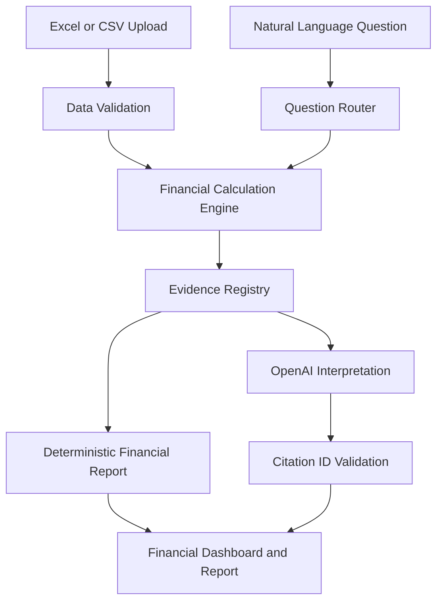

# FinSight AI
### AI-Powered Financial Analyst Copilot

FinSight AI is a financial analytics application that combines
deterministic financial calculations with large language models
to deliver evidence-linked financial analysis, performance
investigations, and executive management recommendations.

## Project Highlights

| Metric | Result |
|---|---:|
| Automated tests passed | 132 |
| Financial source records | 700 |
| 2014 revenue analyzed | $92.31 million |
| Observed AI token reduction | 78.6% |
| Application pages | 7 |
| Financial benchmark categories exercised | 10 |
| Release version | v0.13.1 |

## Business Problem

Financial analysts spend significant time consolidating data,
investigating performance changes, identifying risks, and
preparing management reports.

Traditional AI applications may generate unsupported financial
claims or incorrect calculations. FinSight addresses this
challenge by separating deterministic financial computation
from AI-generated interpretation.

## Core Features

- Financial data validation for Excel and CSV files
- Interactive financial KPI dashboards
- Revenue and gross profit analysis
- Product, country, and segment performance attribution
- Multi-dimensional financial investigations
- Rule-based financial anomaly detection
- Revenue concentration and profitability analysis
- Natural-language financial question routing
- Evidence-linked AI commentary
- Executive financial reporting
- Missing-data and unsupported-metric safeguards

## Application Architecture



Financial calculations are performed locally in Python.
The language model provides qualitative interpretation
and proposed management actions.

Evidence identifiers connect commentary to calculated
financial records.

## Financial Case Study

Using the Microsoft Financial Sample dataset, FinSight
investigated a substantial revenue decline between
October and November 2014.

| Financial Metric | Result |
|---|---:|
| October revenue | $12,375,819.92 |
| November revenue | $5,384,214.20 |
| Revenue change | -$6,991,605.72 |
| Revenue growth | -56.49% |
| Gross profit change | -$1,177,385.72 |
| Gross margin change | -3.17 percentage points |

The investigation identified:

- Carretera as the largest negative product revenue contributor.
- VTT as the largest negative product gross profit contributor.
- Germany as the largest negative geographic contributor.
- Government as the largest negative segment contributor.
- VTT / Germany / Government as a leading negative intersection.

Contribution analysis identifies arithmetic drivers rather
than establishing underlying business causation.

## AI Efficiency Optimization

The application evolved from AI-generated numerical reporting
toward deterministic financial calculations and structured
AI interpretation.

| Version | Observed Reported Tokens |
|---|---:|
| v0.8.0 | 27,006 |
| v0.9.0 | 6,205 |
| v0.10.0 | 6,038 |
| v0.13.1 | 5,774 |

This represents a 78.6% reduction in observed reported token
consumption between the selected benchmark runs.

These results are development observations rather than a
controlled performance experiment.

## Technology Stack

- Python
- Streamlit
- Pandas
- NumPy
- Plotly
- Altair
- OpenAI API
- OpenPyXL
- Pytest
- Git

## Repository Structure

| File | Purpose |
|---|---|
| app.py | Streamlit application |
| data_validator.py | Financial data validation |
| finance_engine.py | Financial calculations |
| evidence_engine.py | Financial evidence registry |
| investigation_engine.py | Multi-dimensional investigations |
| investigation_bridge.py | Investigation integration |
| question_router.py | Natural-language question routing |
| ai_engine.py | AI interpretation |
| deterministic_report.py | Deterministic financial reporting |
| verification_engine.py | Numerical verification utilities |
| claim_mapping.py | Financial claim mapping utilities |
| test_*.py | Automated regression tests |

## Local Installation

Clone the repository:

```bash
git clone https://github.com/fanggmelvin/FinSight-AI.git
cd FinSight-AI
```

Create a Python virtual environment:

```bash
python -m venv .venv
```

Activate on Windows:

```powershell
.\.venv\Scripts\Activate.ps1
```

Install dependencies:

```bash
python -m pip install -r requirements.txt
```

Create a local .env file using .env.example as a template.

Set OPENAI_API_KEY to your own API key.
Never commit your API key to version control.

Launch the application:

```bash
python -m streamlit run app.py
```

The development environment uses Python 3.14.
Compatibility with other Python versions should be tested.

## Automated Testing

Install development dependencies:

```bash
python -m pip install -r requirements-dev.txt
```

Run the test suite:

```bash
python -m pytest -q
```

Latest local regression result: 132 tests passed.

## Example Financial Questions

- Summarize financial performance in 2014.
- Rank products by gross margin.
- Identify the largest revenue concentration risks.
- Which products drove revenue growth in October 2014?
- Why did revenue decline in November 2014?
- Analyze overlapping product, country, and segment drivers.

## Data Source

Microsoft Financial Sample dataset.

Financial figures are derived from sample business data.
Private financial workbooks and API credentials are excluded
from version control.

## Limitations

- AI commentary is not independently verified for factual
  entailment.
- Valid evidence identifiers do not guarantee that every
  associated interpretation is correct.
- Financial contribution analysis does not establish causation.
- Results depend on the quality and completeness of uploaded data.
- Automated tests do not guarantee universal financial accuracy.
- This application is an educational portfolio project, not
  professional financial or investment advice.

## Author

Melvin Fang

University of California San Diego
B.S. Business Economics | Minor in Finance

Developed as a portfolio project demonstrating financial
analysis, financial technology, AI integration, software
testing, and business intelligence.

## Project Status

Release candidate: v0.13.1
