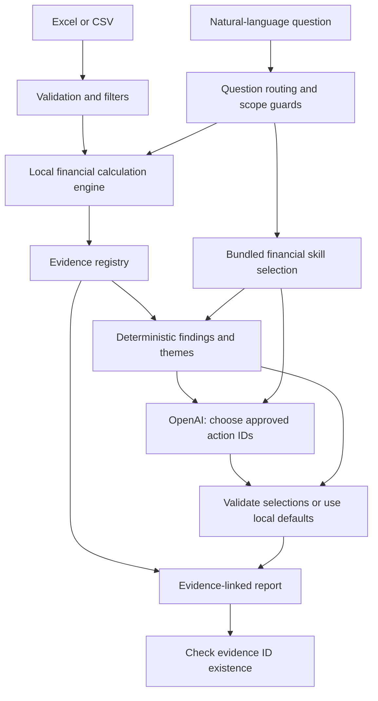

# FinSight AI

**Financial Analyst Copilot | Python · Streamlit · OpenAI**

FinSight AI turns structured financial data into interactive dashboards, evidence-linked performance investigations and management recommendations. Built as a finance and AI engineering portfolio project, it separates financial calculations from language-model decisions to make reporting more reproducible and reduce unsupported numerical claims.

  

## Project at a glance

| Metric | Result |
|---|---:|
| Automated tests passed in local release validation | 195 |
| Live regression workflows exercised successfully | 9 |
| Application pages / bundled financial skills | 7 / 7 |
| Sample dataset records | 700 |
| 2014 sample revenue analyzed | $92.31M |
| Observed token reduction across six workflows vs. v0.14.4 | 74.1% |
| Observed revenue-investigation token reduction vs. v0.8.0 | 96.2% |

## Business problem

Analysts must reconcile financial data, explain changes in performance, prioritize risks and communicate findings to management. Unrestricted language-model reporting can introduce unsupported numbers or causal explanations. FinSight uses local financial computation and constrained AI action selection instead of asking a model to calculate or invent financial results.

## Application walkthrough

| Page | Purpose |
|---|---|
| Overview | Financial KPIs and performance overview |
| Data Upload | Excel/CSV ingestion, worksheet selection and validation |
| Financial Analysis | Revenue, gross profit, margin and dimensional breakdowns |
| Performance Drivers | Period comparisons and contribution analysis |
| Anomaly Detection | Rule-based financial exception flags |
| AI Copilot | Natural-language routing, evidence and contextual action selection |
| Financial Reports | Executive reporting and management priorities |

## Architecture



Financial values, findings, priorities and business implications are generated locally. The model receives calculated themes and selects between approved investigation plans using a strict JSON schema. Invalid or unavailable AI responses fall back to local recommendations. The application checks evidence ID existence; it does not independently audit the financial data or verify factual entailment.

### Modular financial skills

| Skill | Focus |
|---|---|
| `financial-performance` | Overall financial performance |
| `variance-analysis` | Period changes and arithmetic contributions |
| `profitability-analysis` | Gross margin and product profitability |
| `concentration-risk` | Revenue exposure and concentration |
| `anomaly-detection` | Financial exceptions and review priorities |
| `executive-reporting` | Management-oriented reporting |
| `evidence-verification` | Mandatory evidence guidance |

Skills are bundled Markdown instructions selected by deterministic routing. They are not separately trained models.

## Financial case study

Using the Microsoft Financial Sample dataset, the application analyzed 2014 performance and investigated the October-to-November revenue decline.

| Annual metric | 2014 |
|---|---:|
| Revenue | $92,311,094.75 |
| Cost of goods sold | $79,295,857.00 |
| Gross profit | $13,015,237.75 |
| Gross margin | 14.10% |

| Investigation metric | Result |
|---|---:|
| October revenue | $12,375,819.92 |
| November revenue | $5,384,214.20 |
| Revenue change | −$6,991,605.72 (−56.49%) |
| Gross profit change | −$1,177,385.72 |
| Gross margin change | −3.17 percentage points |

The investigation identifies Carretera as the largest negative product revenue contributor, Germany as the largest negative geographic contributor, and Government as the largest negative segment contributor. VTT / Germany / Government is a leading negative intersection. These overlapping dimensions must not be added together.

The annual review also identifies Enterprise's negative gross margin (−2.70%) and Government plus Small Business concentration (79.63% of revenue). These findings support targeted review of pricing, costs, sales mix and demand sensitivity, not conclusions about underlying causation.

## AI efficiency benchmarks

Reported tokens from observed development runs using the same six analytical workflow categories:

| Workflow | v0.14.4 | v0.15.0 | v0.16.0 |
|---|---:|---:|---:|
| Product profitability | 1,637 | 590 | 466 |
| Segment concentration | 1,379 | 582 | 566 |
| Financial summary | 7,200 | 1,786 | 1,269 |
| Anomaly detection | 1,067 | 1,098 | 842 |
| Revenue investigation | 6,041 | 1,230 | 1,028 |
| Executive reporting | 4,003 | 1,869 | 1,352 |
| **Total** | **21,327** | **7,155** | **5,523** |

The observed total fell 74.1% relative to v0.14.4. A separate historical revenue-investigation benchmark fell from 27,006 tokens in v0.8.0 to 1,028 in v0.16.0 (96.2%). Architectures and verification approaches changed across versions; these are development observations, not controlled experiments or guaranteed cost savings. The latest reported counts cover the final model request only.

## Run locally

Development environment: Windows, Python 3.14. Other environments have not been validated for this release.

```powershell
git clone https://github.com/fanggmelvin/FinSight-AI.git
cd FinSight-AI
python -m venv .venv
.\.venv\Scripts\Activate.ps1
python -m pip install -r requirements.txt
Copy-Item .env.example .env
notepad .env
```

Replace the placeholder in `.env` with your own OpenAI API key. Never commit credentials. AI requests can incur charges and transmit calculated financial themes and the question to OpenAI; use non-confidential sample data unless authorized.

```powershell
python -m streamlit run app.py
```

Open the local URL printed by Streamlit. In **Data Upload**, select an Excel or CSV financial dataset and validate it. For the case study, use the Microsoft Financial Sample workbook, available from [Microsoft Learn](https://learn.microsoft.com/en-us/power-bi/create-reports/sample-financial-download). The workbook is not bundled in this repository.

Try these questions in **AI Copilot**:

- Summarize financial performance in 2014.
- Rank all products by gross margin in 2014 and identify profitability risks.
- Why did revenue decline in November 2014? Analyze product, country, and segment contributions.
- Identify unusual financial results and anomalies in 2014.
- Prepare an executive financial performance report for the CFO for 2014.

## Testing and reliability

```powershell
python -m pip install -r requirements-dev.txt
python -m pytest -q
python -m pip check
```

Release validation on the developer's Windows environment: **195 passed in 1.58 seconds**, no broken requirements. Nine live regression checks covered six analytical workflows and three guards: unsupported metrics, unavailable years and ambiguous comparison periods. All three guards prevented an AI request in the tested cases.

## Repository structure

| Module | Responsibility |
|---|---|
| `app.py` | Streamlit interface |
| `data_validator.py` | Input normalization and validation |
| `finance_engine.py` | Financial calculations |
| `evidence_engine.py` | Structured financial evidence |
| `investigation_engine.py`, `investigation_bridge.py` | Contribution investigations |
| `question_router.py`, `reliability.py` | Routing and safeguards |
| `skill_engine.py`, `skills/`, `skill_workflow.py` | Bundled skill selection and workflow utilities |
| `commentary_engine.py`, `narrative_engine.py` | Calculated findings, themes and approved action plans |
| `ai_engine.py` | OpenAI integration and selection validation |
| `deterministic_report.py` | Local financial report rendering |
| `verification_engine.py`, `claim_mapping.py` | Verification utilities |
| `test_*.py` | Test suite and connection diagnostic |

**Stack:** Python, Streamlit, Pandas, NumPy, Plotly, Altair, OpenAI API, OpenPyXL, Pytest and Git.

## Limitations

- Gross profit is not net income. Unsupported metrics require additional data.
- Contribution analysis is arithmetic attribution, not proof of causation.
- Anomaly and priority thresholds are illustrative review rules, not audited materiality standards.
- Evidence ID checks do not prove factual entailment or source-data accuracy.
- AI selects predefined investigation plans rather than performing unrestricted autonomous financial reasoning.
- Results depend on the uploaded data, and passing tests do not guarantee universal correctness.
- This is an educational portfolio project, not production financial software or investment advice.

## Author

**Melvin Fang** — University of California San Diego, B.S. Business Economics, Minor in Finance.

Built to demonstrate financial analysis, business intelligence, applied AI integration and software reliability.

**Release:** v0.16.0
